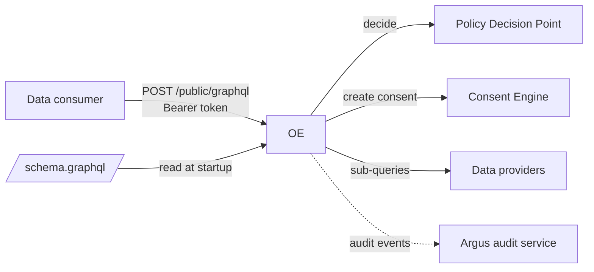
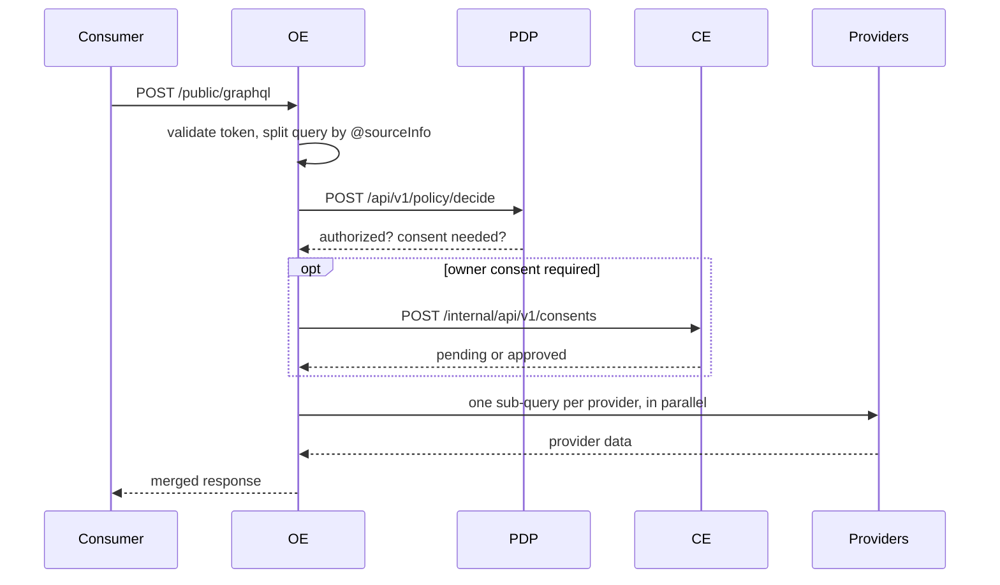

# Orchestration Engine (OE)

The data-exchange gateway. A data consumer sends one GraphQL query; the OE checks access with the Policy Decision Point, obtains the data owner's consent through the Consent Engine, fetches the data from the providers that hold it, and returns one merged response.

## Overview



The OE splits a consumer query into one sub-query per provider using `@sourceInfo` directives in its GraphQL schema, so consumers never see which provider holds which field. It reads that schema from a file at startup and keeps no database. The only callers are data consumers (machine clients).

## Quick start

With Docker Compose, the full stack including the OE (from the repo root):

```bash
docker compose up --build orchestration-engine
curl http://localhost:4000/health
```

Compose mounts `cmd/oe/config.docker.json` and `cmd/oe/schema.graphql` into the container. The sample providers are the mock APIs in [dev/](../../dev/README.md).

Native, from the repo root:

```bash
cp cmd/oe/config.example.json cmd/oe/config.json     # git-ignored
# Consumer tokens: ThunderID from `docker compose up thunderid`, whose `iss` is its base URL
export IDP_JWKS_URL=http://localhost:8090/oauth2/jwks IDP_ISSUER=http://localhost:8090 \
  IDP_AUDIENCE=http://api.openndx.local
make run orchestration-engine
```

Use `make run`, not `go run ./cmd/oe`. `make run` starts the service from `cmd/oe`, which is where `./config.json` and `./schema.graphql` are read. To run from elsewhere, set `CONFIG_PATH` and `SCHEMA_PATH` (see [CONFIGURATION.md](CONFIGURATION.md#schema)).

To send a real query you need a consumer token, registered policy metadata and an application grant. Follow the [walkthrough](../../dev/WALKTHROUGH.md), or the token and curl example in [dev/README.md](../../dev/README.md).

## Configuration

The OE reads a JSON file (`CONFIG_PATH`, default `./config.json`), the consumer schema file (`SCHEMA_PATH`, default `./schema.graphql`), and a few environment variables. Both files are read once at startup; to change either, deploy the new file and restart.

| `config.json` key | Meaning |
|---|---|
| `foundationalIdArgName` | **Required.** Name of the query argument that identifies the data owner, for example `nic`. The service exits at startup without it. |
| `pdpUrl` | PDP base URL. If empty, the OE skips authorization and consent checks (see Security). |
| `ceUrl` | Consent Engine URL **including** `/internal/api/v1`. |
| `providers[]` | Data providers: `providerKey`, `providerUrl`, `schemaId`, optional `auth`. See [PROVIDER_CONFIGURATION.md](PROVIDER_CONFIGURATION.md). |
| `argMappings[]` | How consumer arguments map to each provider's arguments. |
| `auditConfig` | Argus audit service URL and actor identity. |

| Environment variable | Default |
|---|---|
| `PORT` | `4000` |
| `CONFIG_PATH` | `./config.json` |
| `SCHEMA_PATH` | `./schema.graphql` |
| `IDP_JWKS_URL`, `IDP_ISSUER`, `IDP_AUDIENCE` | Consumer token validation; `IDP_AUDIENCE` is required. See [AUTHENTICATION.md](AUTHENTICATION.md). |
| `AUDIT_SERVICE_URL`, `ARGUS_API_KEY` | override `auditConfig.serviceUrl`; audit API key |

Every key and variable, with the error codes: [CONFIGURATION.md](CONFIGURATION.md). No `.env` file is loaded; export variables or use Docker `--env-file`.

## API

| Method and path | Auth | Purpose |
|---|---|---|
| `POST /public/graphql` | Bearer token | Federated query. Body `{query, variables, operationName}`; response `{data, errors}`. Only one `query` operation per request. |
| `GET /health` | none | `{"message": "OpenNDX Server is Healthy!"}` |

[openapi.yaml](openapi.yaml) describes `/health`. `/public/graphql` is described here and in [AUTHENTICATION.md](AUTHENTICATION.md).

## How it works



- The consumer's identity is the token's `client_id`. It is sent to the PDP as `applicationId`.
- Each field's `providerField` and `schemaId` become the `(schemaId, fieldName)` the PDP looks up, so every field must have policy metadata registered.
- If consent is not yet approved, the response is HTTP 200 with `errors[0].extensions.code = CE_NOT_APPROVED`, plus `consentPortalUrl` and `consentStatus`. The citizen approves in the Consent Portal and the consumer repeats the query.
- Federation errors come back as HTTP 200 with `errors[].extensions.code` (`PDP_NOT_ALLOWED`, `CE_NOT_APPROVED`, `MISSING_IDENTIFIER`, and others; see [CONFIGURATION.md](CONFIGURATION.md#error-codes)). Only an unreadable body (`400`) or a missing or invalid token (`401`, JSON) use HTTP error statuses.
- A provider that fails is left out of the result, and the failure is audited. The response is still HTTP 200.

## Security and deployment

> **Deployment security.** Only `/public/graphql` requires a token. `/health` is not authenticated; expose only `/public/graphql` to consumers.

- Consumer tokens are always verified against the IdP's keys (`IDP_JWKS_URL`), issuer and audience ([AUTHENTICATION.md](AUTHENTICATION.md)).
- With `pdpUrl` empty, the OE returns provider data without any authorization or consent check. Always set it.
- CORS allows every origin.
- Audit events (`DATA_REQUEST`, `POLICY_CHECK`, `CONSENT_CHECK`, `PROVIDER_FETCH`) go to Argus. If Argus is down, batches are lost.

## Development

```bash
make validate-test orchestration-engine        # tests with -race and coverage
go test ./cmd/oe/... ./internal/oe/... -count=1
make quality-check orchestration-engine
```

[HOW_TO_TEST.md](HOW_TO_TEST.md) covers unit and golden tests, changing the schema, and trying queries. Code is in [`internal/oe`](../../internal/oe): `server` (routes), `federator` (query splitting and merging; `federator/schema` loads the schema file), `auth`, `policy` and `consent` (clients), `provider`, `configs`.

## More docs

- [CONFIGURATION.md](CONFIGURATION.md): all `config.json` keys, environment variables, error codes, the schema file
- [AUTHENTICATION.md](AUTHENTICATION.md): token validation, `IDP_*` settings, JWKS handling
- [PROVIDER_CONFIGURATION.md](PROVIDER_CONFIGURATION.md): adding a data provider
- [HOW_TO_TEST.md](HOW_TO_TEST.md): testing and manual checks
- [Policy Decision Point](../pdp/README.md) and [Consent Engine](../ce/README.md): the services the OE calls
