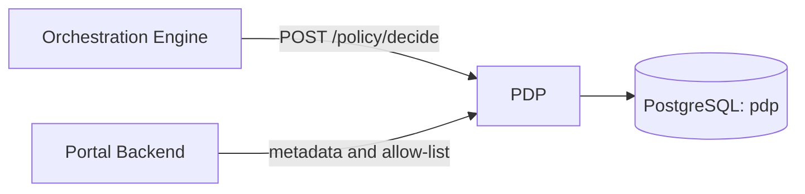

# Policy Decision Point (PDP)

Stores field-level policy metadata and per-application allow-lists, and answers one question for the Orchestration Engine: *may this application read these fields, and does the data owner need to consent?*

## Overview

The PDP is a leaf service. It calls nothing else and stores everything in its own PostgreSQL database (`pdp`).



| Caller | Uses |
|---|---|
| Orchestration Engine | `POST /api/v1/policy/decide` before every federated query |
| Portal Backend | metadata and allow-list endpoints, when schemas and applications are approved or edited |

There is no policy language or rules engine. The decision is a lookup over the `policy_metadata` table (see [POLICY_MODEL.md](POLICY_MODEL.md)).

## Quick start

With Docker Compose (from the repo root; starts PostgreSQL first):

```bash
docker compose up --build policy-decision-point
curl http://localhost:8082/health
```

Native, against a local PostgreSQL with an empty `pdp` database. The service does not create tables, so load the schema first:

```bash
PGPASSWORD=<password> psql -h localhost -U postgres -d pdp \
  -v ON_ERROR_STOP=1 -f cmd/pdp/schema.sql

cp cmd/pdp/config.example.yaml cmd/pdp/config.yaml    # once; config.yaml is git-ignored
export DB_PASSWORD=<password>
make run policy-decision-point    # or: go run ./cmd/pdp -config cmd/pdp/config.yaml
```

[config.example.yaml](config.example.yaml) points at `localhost:5432` as user `postgres` and reads the password from `DB_PASSWORD`. Schema changes go directly into [schema.sql](schema.sql); there is no versioned upgrade path.

## Configuration

The PDP reads one YAML file: the `-config` flag, else `CONFIG_PATH`, else `config.yaml` in the working directory. There are no other flags or environment variables. The Docker image sets `CONFIG_PATH=/app/config/config.yaml` and has no config file of its own, so mount one there. Compose mounts [config.docker.yaml](config.docker.yaml).

A value written as `"{{env:NAME}}"` or `"{{file:/path}}"` is read from that environment variable or file at startup, so secrets stay out of the file. The placeholder must be the whole value, and an unset or empty variable stops the service.

| Key | Default | Notes |
|---|---|---|
| `server.port` | `8082` | Listen port. The server binds on all interfaces. |
| `server.timeout` | `10s` | Read and write timeout. |
| `environment` | none | Deployment name (for example `local`, `staging`), added to every log line. Left out of log lines when empty. |
| `logging.level` | `info` | `debug`, `info`, `warn` or `error`. |
| `logging.format` | `json` | `json` or `text`. Every line carries `service`, `version` and, when set, `environment`. |
| `database.driver` | `postgres` | Only `postgres` is supported. |
| `database.postgres.host`, `.user`, `.password` | none | **Required.** |
| `database.postgres.port` | `5432` | |
| `database.postgres.name` | `pdp` | |
| `database.postgres.sslMode` | `require` | Use `disable` for a local PostgreSQL without TLS. |
| `database.postgres.pool.maxOpenConns`, `.maxIdleConns`, `.maxConnLifetimeSeconds` | `25`, `5`, `3600` | Connection pool. |
| `database.idleTimeout` | `30m` | Closes connections idle this long. |

The service checks the file at startup and exits with an error naming the bad key. Keys it does not know are ignored, so check the spelling of any key that seems to have no effect.

## API

Full request and response schemas: [openapi.yaml](openapi.yaml). Success bodies are the bare resource and errors are `{"error": "<message>"}`.

| Method and path | Purpose |
|---|---|
| `POST /api/v1/policy/decide` | Authorization decision for an application and a list of fields |
| `GET /api/v1/policy/metadata?schemaId=` | List metadata records, optionally for one schema |
| `POST /api/v1/policy/metadata` | Sync a schema's field metadata (`201`) |
| `PATCH /api/v1/policy/metadata/{id}` | Edit `displayName`, `description` or `accessControlType` |
| `DELETE /api/v1/policy/metadata/{id}` | Delete a record (`204`) |
| `DELETE /api/v1/policy/metadata/{id}/allowlist/{applicationId}` | Revoke one application's access to one field (`204`) |
| `POST /api/v1/policy/update-allowlist` | Grant an application access to fields for `30d` or `365d` |
| `GET /health` | `{"service": "policy-decision-point", "status": "healthy"}` |
| `GET /debug`, `GET /debug/db` | Version info; database status and record count |

A decision request and response:

```json
{ "applicationId": "passport-app",
  "requiredFields": [{ "schemaId": "drp-v1", "fieldName": "person.fullName" }] }
```

```json
{ "appAuthorized": true, "unauthorizedFields": [],
  "appAccessExpired": false, "expiredFields": [],
  "appRequiresOwnerConsent": false, "consentRequiredFields": [] }
```

`applicationId` is the OIDC `client_id` of the calling application. Metadata and allow-list requests use camelCase keys; see the schemas in `openapi.yaml`.

## How it works

For each requested `(schemaId, fieldName)`, in order:

1. No metadata record: the whole request fails with **HTTP 500**.
2. The application is not in the field's allow-list: the field is *unauthorized*.
3. The allow-list entry has expired: the field is *expired*.
4. Otherwise the field needs owner consent if it is `restricted` and the caller is not the field's owner (`isOwner: false`).

`appAuthorized` is true when no field is unauthorized. A `public` field still needs an allow-list entry. Field semantics and the table schema are in [POLICY_MODEL.md](POLICY_MODEL.md).

## Security and deployment

> **Deployment security: network isolation.** No PDP route is authenticated. Anyone who can reach port 8082 can read and rewrite policy. Expose it only on the internal network, reachable by the Orchestration Engine and Portal Backend.

## Development

```bash
make validate-test policy-decision-point    # tests with -race and coverage
go test ./cmd/pdp/... ./internal/pdp/... -count=1
make quality-check policy-decision-point    # format, vet, lint, security
```

Tests use an in-memory SQLite database, so no PostgreSQL is needed. The configuration is in [`config.go`](config.go). Code is in [`internal/pdp`](../../internal/pdp): `handler` (HTTP), `services` (decision and metadata logic), `models`.

## More docs

- [POLICY_MODEL.md](POLICY_MODEL.md): field semantics, decision rules, table schema
- [openapi.yaml](openapi.yaml): API reference
- [Orchestration Engine](../oe/README.md) and [Portal Backend](../pb/README.md): the two callers
